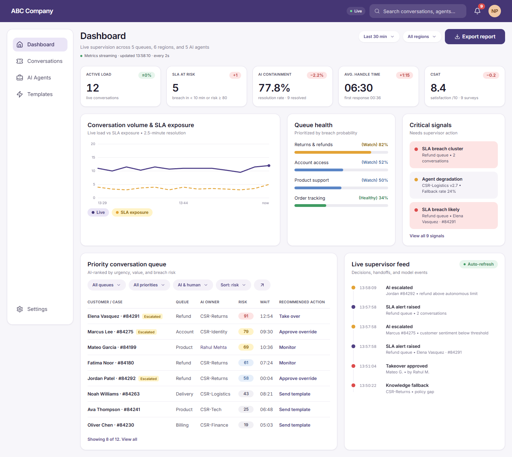
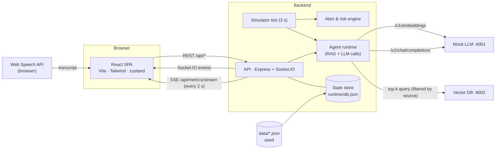

# AI Agent Supervisor Workstation

A workstation for human supervisors to **monitor** AI customer-service agents in real time, **intervene** in conversations (take over, reply by typing or **by voice**, hand back with notes) and **improve** the agents (tune parameters and capabilities, set escalation thresholds, simulate, evaluate, deploy and save presets).

It also covers the **additional requirements** sent on 20 Oct:
- **Response templates** with `{{variable_name}}` placeholders, scenario categories, team sharing, and fill-in-and-preview inside a conversation.
- **Dashboard metrics pushed over Server-Sent Events every 2 seconds.**
- A **mobile-responsive dashboard.**
- **Voice replies** through the Web Speech API.

See [Additional requirements](#additional-requirements-20-oct-email).

Built against the Figma file *R2 Assessment for FSD*. Reference renders of each frame are in [docs/design/](docs/design/), screenshots of the implementation are in [docs/screenshots/](docs/screenshots/).



More screens: [intervention](docs/screenshots/02-intervention.png) · [template usage + variables](docs/screenshots/03-template-usage.png) · [voice input](docs/screenshots/10-voice-input.png) · [return to AI](docs/screenshots/04-return-to-ai.png) · [agent config](docs/screenshots/05-agent-config.png) · [template management](docs/screenshots/06-template-management.png) · [template editor](docs/screenshots/07-template-editor.png) · [mobile dashboard](docs/screenshots/08-mobile-dashboard.png) · [mobile conversation](docs/screenshots/09-mobile-conversation.png)

---

## Quick start

**Requirements:** Node.js 20+ (tested on Node 24). Use Google Chrome or Microsoft Edge for voice input, which needs the Web Speech API. Chrome is also used by the optional end-to-end test.

```bash
npm install        # installs all four workspaces
npm run dev        # starts mock LLM, vector DB, API and web app together
```

Open **http://localhost:5173**. The four services:

| Service | Port | What it is |
|---|---|---|
| Web app | 5173 | React SPA (Vite dev server, proxies `/api` and `/socket.io`) |
| Backend API | 4000 | Express REST API + Socket.IO realtime + simulator |
| Mock LLM | 4001 | OpenAI-compatible `/v1/chat/completions` and `/v1/embeddings` |
| Vector DB | 4002 | In-memory vector store with cosine top-k search |

**With Docker:**

```bash
docker compose up --build    # then open http://localhost:5173
```

**Other commands**

| Command | Does |
|---|---|
| `npm test` | 28 unit tests: mock LLM (11), backend rules and template sharing (8), template variables and voice transcript handling (9) |
| `npm run typecheck` | TypeScript checks for backend and frontend |
| `npm run e2e` | 17 end-to-end UI flows in your installed Chrome, including the SSE refresh, voice reply (scripted speech) and phone layout. Needs `npm run dev` running and changes demo data. |
| `npm run build` | Production build of the web app |
| `npm run reset-data` | Re-seed runtime state from `/data` (also available in **Settings → Reset demo data**) |

State persists in `backend/runtime/db.json`. On restart, timestamps are shifted forward so the demo resumes where it left off instead of showing hours-old waits.

### A five-minute tour

1. **Dashboard**: the line under the title shows *"Metrics streaming · updated hh:mm:ss · every 2s"*, and KPIs, the trend chart and queue health refresh over SSE. Click a queue in *Queue health* to filter the table. Click **Take over** on Elena Vasquez. Narrow the window, or open it on a phone, for the mobile layout.
2. **Conversation**: you're now in control (the AI is paused). Open **Template ▾** and pick *Refund delay apology*. The **Variables** form shows each `{{variable}}`: auto-filled ones are green ("Auto · from the conversation"), the one it can't know (*follow-up time*) is amber "Required". Fill it, check the completed-message preview, click **Use**, then send.
3. Click the **mic** next to *Send reply* and speak. Words appear live, and when you stop, the reply is sent after a 3-second countdown (**Send now** / **Edit first**). It shows in the thread tagged *Sent by voice*. Language and auto-send are in **Settings → Voice input**, which also has a mic test.
4. Click **Return to AI**, add notes and keep "share with AI" on. The AI's next message uses your notes.
5. Open Marcus Lee and click **Approve action** on the co-pilot recommendation.
6. **AI Agents**: drag *Max tokens* down to ~50. A draft and change request appear, and the **Simulation console** re-runs the scenario with the reply now *Truncated*. Raise *Refund value* above ₹5,000 and click **Run evals**: refund reasoning drops and the risk becomes *High*. **Review & deploy** shows the diff, or discard it. Try **Presets**.
7. **Templates**: **Create template** with `{{user_name}}`-style variables, pick a category (Shipping, Returns, … or **+ New category…**), and choose *Share with Team* or private. Filter the library **By category**, edit, favourite, delete.
8. **Settings**: switch supervisor to "Rahul Mehta" in a second tab. You'll see the one-supervisor-per-conversation lock, and that their library doesn't show your private templates. Pause or speed up the simulator, or reset data.

---

## Requirements coverage

| Requirement | Where / how |
|---|---|
| **1. Monitoring dashboard** | |
| Real-time view of conversations | Socket.IO pushes conversation, message, alert and feed events. The priority queue, conversation list and threads update live with ticking wait/SLA timers. A simulator generates customer traffic, and AI replies go through the mock LLM. |
| Key metrics (resolution rate, response time, satisfaction) | KPI cards: Active load, SLA at risk, **AI containment = resolution rate**, **Avg handle time + first-response time**, **CSAT**. Each shows a delta against the previous window, filterable by time range (30 min to 7 days) and region. Pushed over **SSE every 2 s**. |
| Alert system for problematic conversations | Rule engine driven by each agent's escalation thresholds: SLA breach, negative sentiment, low AI confidence, refund over limit, no agent response. Fleet signals: SLA cluster, regional sentiment anomaly, agent degradation. Alerts show in *Critical signals*, the bell menu (acknowledge / acknowledge all) and as toasts, and banner the conversation itself. Auto-escalation moves the chat to the supervisor queue. |
| Filtering options | Queue, priority, AI/human control and sort on the dashboard table (kept in the URL), time range and region for KPIs, conversation list tabs (Open / Mine / Escalated / Resolved) and search, global search (press `/`). |
| **2. Intervention interface** | |
| View full conversation history | Full thread with customer, AI (confidence, cited policy, truncation), supervisor, system events and internal notes. |
| "Take over" | Pauses the AI and locks the chat to you. A second supervisor gets HTTP 409, and an in-flight AI reply is discarded. |
| Return control to AI with notes | **Return to AI** modal. Notes are stored as internal (customer-invisible) notes and, if shared, sent to the model as context, so the AI resumes with them. |
| Send messages as supervisor | Composer (Enter to send), **voice dictation** (mic button) and templates. Typing while the AI is in control offers **Take over & send**. |
| **3. Agent configuration** | |
| AI parameters (temperature, max tokens) | Sliders for creativity/temperature, max tokens, response speed, empathy and stability. They are sent to the LLM on every reply, and the simulation console shows the effect immediately. |
| Enable/disable capabilities | 7 capability toggles (refunds, order lookup, knowledge base, auto-escalate, …) plus per-source knowledge toggles with a live retrieval tester. |
| Configure escalation thresholds | No-response seconds, sentiment, refund value, confidence. These feed the alert engine and the model's escalation decisions. |
| Save configuration presets | **Presets ▾**: 4 built-in, save current settings as a new preset, apply to a draft, delete custom ones. |
| **Updated brief: templates** | |
| Template Management screen | *Template Governance Workspace*: library (popular / low use / **by category** / by channel), search, channel and sort filters, tabs (All / My team / Recently used), Team or Private badges, personal favourites, edit/delete (owner only), use in a conversation. |
| Template Creation modal | Name, title, **category** (Shipping, Returns, Billing, Account, Product, Onboarding, Engagement, General, or a new one), message type, channels, content with formatting toolbar and **Insert variable** menu, inline `{{variable}}` highlighting, validation of malformed placeholders, live preview, **Share with Team**. |
| Template Usage interface | Picker from the conversation composer. *Preview as* defaults to the current customer, with a **Variables** form (auto-filled, editable, required) and a completed-message preview. |
| **Variable substitution clearly indicated** | Grey `‹user name›` tokens in the editor preview. Green highlighted values when filled (hover shows `{{var}} → value`). Every variable is labelled *Auto · from the conversation*, *Edited*, *Entered by you* or *Required*. A summary reads e.g. *"4 variables resolved: customer first name, order id and case id from the conversation; follow-up time entered by you"*. The composer highlights leftover `{{vars}}` and blocks sending (UI and server, 422). |

Beyond the brief: co-pilot recommendations (approve / edit / escalate), governed config changes (draft → change request with risk rating → evals → deploy with version bump and *Compare v4.2*), CSV export, live/paused supervisor feed.

### Additional requirements (20 Oct email)

| Requirement | Implementation |
|---|---|
| **1. Template creation** | |
| Variables in `{{variable_name}}` format | Insert-variable menu (customer name, order ID, case ID, refund amount, supervisor name, delivery date, follow-up time, …) or type any `{{lower_snake_case}}` name. Placeholders are highlighted as you type, and malformed ones (`{{User Name}}`, unbalanced braces) are rejected in the UI and by the API (400). |
| Categorize templates (shipping, returns, etc.) | `category` is a scenario: **Shipping, Returns, Billing, Account, Product, Onboarding, Engagement, General**, or a custom one via *+ New category…*. The library sidebar filters **By category** with counts. Message format (Chat/Email/SMS) is a separate *type*. |
| Option to share templates with team | **Share with Team** toggle. Shared templates are visible to every supervisor (*Team* badge, *My team* tab). Private ones are returned by the API only to their author (*Private* badge). Only the author can edit or delete (403 otherwise). Favourites are per supervisor. |
| **2. Template usage in conversations** | |
| Access template library during intervention | **Template ▾** in the conversation composer opens the full library (search, category/channel filters, tabs). Templates can also be started from the Templates screen (**Use in a conversation**). |
| Select template and fill in variables | The **Variables** form lists every placeholder. Known values are filled from the conversation (customer, case, order, refund amount, supervisor), all fields are editable, and unknown ones are marked *Required*. |
| Preview completed message before sending | The *Live preview · completed message* panel renders the final text with substituted values highlighted. **Use** puts the completed message in the reply box for a last review, and sending is blocked while any `{{variable}}` remains. |
| **3. Metrics every 2 s via SSE** | `GET /api/metrics/stream?range=&region=` is a `text/event-stream` that pushes freshly computed KPIs, trend and queue health every 2 s (`event: metrics`, `id`, `retry: 3000`). The dashboard subscribes with `EventSource` (`useMetricsStream`), shows the last-update time, and reconnects automatically when the connection drops. nginx config disables buffering for the stream. |
| **4. Mobile-responsive dashboard** | Tested at 390 px: 2-column KPI grid, stacked panels, the priority queue becomes cards (no horizontal scroll), the search collapses to an icon, and a bottom tab bar replaces the sidebar. Other screens stack too. |
| **5. Voice input in the conversation** | Mic button in the composer uses the **Web Speech API** (`SpeechRecognition` / `webkitSpeechRecognition`). Live interim transcript, spoken punctuation ("comma", "full stop", "question mark"), and the final text goes into the reply. With *auto-send* on (default) it is added to the conversation after a 3-second countdown (**Send now** / **Edit first**). Messages are tagged *Sent by voice* and recorded in the feed. **Settings → Voice input** has language (en-IN default, en-US, en-GB, hi-IN, es-ES), auto-send and a microphone test. Unsupported browsers get a disabled mic with an explanation, and errors (permission denied, no speech, network) show as toasts. |

---

## Architecture



### Services

- **`frontend/`**: React 18 + TypeScript + Tailwind v4, routes `/`, `/conversations/:id`, `/agents/:agentId`, `/templates`, `/settings`.
  - Realtime: a single Socket.IO connection feeds a zustand store (`src/store/live.ts`) with entity events (conversations, messages, alerts, feed), and everything refetches after a reconnect so no events are lost. Dashboard metrics come over a separate **SSE** stream (`src/lib/useMetricsStream.ts`).
  - Voice dictation is in `src/lib/useSpeechRecognition.ts`. Template variable logic is in `src/lib/templateVars.ts`.
- **`backend/`**: Express + Socket.IO in TypeScript (run with `tsx`). Validates input with zod, holds state in memory and persists it to JSON.
  - `services/agentRuntime.ts`: AI reply pipeline, handback resume, co-pilot, simulation console, eval suite.
  - `services/alerts.ts`: pure rule functions plus a reconciler that raises, updates and clears alerts.
  - `services/risk.ts`: breach-risk score, `1 − Π(1 − wᵢ·fᵢ)` over sentiment, SLA pressure, AI confidence, repeat contact, refund over limit, VIP and escalation status. It drives priority and the recommended action.
  - `services/metrics.ts`: KPIs and deltas, trend buckets from monitoring snapshots, queue breach probability, per-agent performance.
  - `services/agentConfig.ts`: drafts, diffs, governance risk rating, deploy/version bump, presets.
  - `services/simulator.ts`: customers follow up, thank (letting the AI resolve), answer supervisors and get impatient when escalated. New chats arrive, and other supervisors pick up stale escalations.
- **`mock-llm/`**: deterministic, OpenAI-compatible model. Keyword NLU (intent, sentiment, amounts, prompt injection, context carry-over) plus templated generation that honours the agent's config:
  - **temperature**: seeded variation, so 0 is fully deterministic
  - **max_tokens**: truncation with `finish_reason: "length"`
  - **empathy**, **response speed** (latency, citation verbosity) and **stability**
  - **capabilities**: e.g. no refunds means routing to the returns team
  - **knowledge context**: cites the retrieved policy
  - **escalation thresholds**

  It also returns an `analysis` block (intent, sentiment, confidence, escalate, citations). Embeddings are 256-dim feature-hashed bag-of-words.
- **`vector-db/`**: collections, upsert and cosine top-k with payload filters, with optional JSON persistence. The backend indexes `data/knowledge-base.json` on start-up and retries until both services are up.

### AI reply pipeline (per customer message)

1. Simulator (or a real customer) appends a message, and the conversation is pushed to clients.
2. If the AI controls the chat and has the *knowledge base* capability on, the backend embeds the message and queries the vector DB, filtered to the agent's enabled sources.
3. It calls `/v1/chat/completions` with the transcript, a system prompt (persona, capabilities, thresholds, shared supervisor notes, retrieved docs), `temperature`, `max_tokens` and metadata.
4. The reply is appended. Sentiment, confidence and agent fallback-rate (EMA) are updated, and auto-escalation or AI resolution applies. If a supervisor took over meanwhile, the reply is dropped.
5. The alert engine reconciles on the next tick (≤ 3 s) and clients receive `alert:updated`, `feed:new` and `metrics:changed`.

### API (all under `/api`; the acting supervisor is sent as the `x-supervisor` header)

| Method & path | Purpose |
|---|---|
| `GET /conversations?status=&queue=&priority=&control=&region=&q=&sort=` | List summaries |
| `GET /conversations/:id` | Summary + full message history |
| `POST /conversations/:id/takeover` · `/return {notes, shareWithAi}` · `/messages {text, templateId?, source: typed\|voice\|template}` · `/resolve {notes?}` | Intervention (409 on lock conflicts, 422 on unfilled `{{variables}}`) |
| `GET /metrics/stream?range=&region=&interval=2000` | **Server-Sent Events**: `event: metrics` with the full metrics payload every 2 s |
| `PUT /conversations/:id/notes` · `GET /:id/copilot` · `POST /:id/copilot/approve` · `POST /:id/escalate-policy` | Notes and co-pilot |
| `GET /metrics?range=&region=` · `GET /alerts` · `POST /alerts/:id/ack` · `POST /alerts/ack-all` · `GET /feed` | Monitoring |
| `GET /agents` · `GET /agents/:id` · `PUT/DELETE /agents/:id/draft` · `POST /agents/:id/deploy` · `POST /agents/:id/simulate` · `POST /agents/:id/evals` | Configuration |
| `GET/POST /presets` · `DELETE /presets/:id` | Presets |
| `GET/POST /templates` · `PUT/DELETE /templates/:id` · `POST /templates/:id/favorite` | Templates (list returns team-shared plus your own private templates; edit/delete are owner-only) |
| `GET /search?q=` · `GET /knowledge/search` · `GET /export/report.csv` · `GET/PUT /simulator` · `POST /admin/reset` · `GET /health` | Utilities |

Socket events (server → client): `conversation:updated`, `message:new`, `alert:updated`, `feed:new`, `metrics:changed` (coalesced to ≤ 1/s), `agent:updated`, `templates:changed`, `presets:changed`, `simulator:updated`, `state:reset`.

### Project structure

```
backend/      API, realtime, rules, simulator (src/services, src/routes), tests/
frontend/     React app (src/pages, src/components/{dashboard,conversation,agent,templates,layout})
mock-llm/     OpenAI-compatible mock model + tests
vector-db/    Vector store service
data/         Seed data: conversations, agents, presets, templates, knowledge base, eval scenarios, simulator scripts
e2e/          Playwright UI flows (runs in installed Chrome)
docs/         Figma renders and implementation screenshots
```

---

## Assumptions

- **Starter code.** The brief points to a Google Drive folder (Docker setup, starter code, mock LLM, vector DB, sample data), but the link was missing from the PDF. The repo provides equivalents of each piece behind standard interfaces: an OpenAI-style chat/embeddings API and a small HTTP vector store. Real services can be swapped in through `MOCK_LLM_URL` / `VECTOR_DB_URL`.
- **Template requirements.** The original PDF only kept "variable substitution should be clearly indicated" and the three screen names. The 20 Oct email gave the full specification, which is implemented as described above on top of the Figma frames. Variables use `{{snake_case}}`, known ones fill from the conversation, and the rest must be typed in before sending.
- **One combined project.** Per the email, the additional requirements are built into this same codebase rather than a separate project.
- **Design additions** where a requirement needed a control the mock doesn't show: the Max tokens slider, the Capabilities/Knowledge tab contents, Presets menu, Return-to-AI modal, alerts bell, queue-table filters, Settings page. They reuse the design's components and tokens. The design uses ₹ and Indian number formatting, which the app keeps.
- **No authentication.** Supervisor identity is chosen in Settings and sent as a header. It drives locks, notes and the audit feed.

## Challenges and solutions

1. **Missing starter code and an incomplete template spec.** I built the missing services (mock LLM, vector DB, seed data, Docker setup) behind standard interfaces and inferred the template feature from the Figma frames plus the one surviving requirement line. The interpretation is written down above.
2. **Reading the Figma without edit/API access.** The file is public, so I rendered its embed in headless Chrome at 2× and cropped each frame. Exact colours were sampled from the renders and are kept as design tokens in `index.css`.
3. **Making "real-time" real.** A server-side simulator drives realistic traffic, and Socket.IO pushes deltas. Metrics change constantly, so the server coalesces `metrics:changed` to at most once a second and clients refetch with their own filters. One shared 1-second clock powers every countdown.
4. **Making configuration matter.** Sliders that change nothing are a common trap. The mock LLM reacts deterministically to temperature, max tokens, empathy, capabilities and retrieved knowledge. The simulation console and eval suite grade replies against *company policy* (not the agent's own thresholds), so a risky config, e.g. a refund limit above policy with auto-escalate off, visibly fails before it is deployed.
5. **Over-eager escalation.** The first version escalated 9 of 10 seeded chats within seconds. There were two causes: stale seed timestamps tripped the "no agent response" rule on boot, and keyword NLU couldn't read follow-ups like "please hurry". I fixed it with context carry-over in the mock model and realistic seed timings. I also found and fixed a handback bug where "replacement approved" notes produced a refund confirmation.
6. **Safe intervention under concurrency.** A one-supervisor lock (409), dropping AI replies that finish after a takeover, and server-side rejection of unfilled template variables (422). The UI never has to be the only guard.
7. **Restarts mid-demo.** State persists to JSON and timestamps shift by the downtime on load, so waits and SLAs stay realistic.
8. **Late requirements in the same codebase.** The additional requirements arrived mid-assessment. Templates already existed, so the work was a schema change (scenario `category` + message `type`, owner and visibility rules, per-user favourites) with the seed data migrated and old state re-seeded through a schema version bump. Nothing was added as a parallel feature.
9. **SSE next to WebSockets.** Socket.IO stays the channel for entity events, and SSE carries the metrics as the brief asks. The stream sends `retry`, disables proxy buffering (`X-Accel-Buffering: no`, nginx `proxy_buffering off`) and clears its timer when the client disconnects. The dashboard shows when the last frame arrived, so a stalled stream is visible.
10. **Voice input that is safe to auto-send.** Speech recognition can mishear, but the brief wants speech added to the conversation. The transcript appears live, then auto-sends after a 3-second **Send now / Edit first** countdown that any keystroke cancels. Auto-send can be turned off. Recent Chrome exposes both `SpeechRecognition` and `webkitSpeechRecognition`, so the app prefers the standard name, and the end-to-end test replaces both with a scripted recogniser because headless browsers have no microphone.

## Limitations and next steps

- The mock model's NLU is keyword-based. A real LLM needs a structured-output step to produce the `analysis` block (intent, sentiment, confidence).
- JSON-file persistence suits a single instance. Production would use Postgres plus Redis pub/sub for multi-instance Socket.IO.
- No auth or RBAC. Supervisor identity is self-declared.
- Voice input relies on the browser's speech service: Chrome sends audio to Google, so it needs an internet connection and microphone permission. Firefox has no Web Speech recognition, so the mic is disabled there with an explanation.
